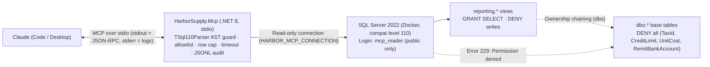

# sqlserver-readonly-mcp

A reference implementation of a **read-only Model Context Protocol (MCP) server** in C# / .NET 8 that lets Claude query an on-premises-style SQL Server database (`HarborSupply`, synthetic ERP data) through an approved `reporting` view layer only.

> **Honest scope:** This is a working reference build on synthetic data ("Harbor Supply Co."), not a production deployment. Claude answers five business questions through read-only access, the answers reconcile to reference reports, and the permission denials are covered by automated tests. See [Limits](#limits-and-honest-scope). A Data API Builder variant is a possible stretch, not built.

**Demo clip:** _not yet recorded_ (add the link here).

## Architecture

Security is enforced in two layers: **SQL Server permissions are the real control**, and **the MCP server's AST query guard is defense in depth**.



## Quick Start

Prerequisites: [Docker Desktop](https://www.docker.com/products/docker-desktop/) and [.NET 8 SDK](https://dotnet.microsoft.com/download/dotnet/8.0).

1. **Configure environment and start SQL Server** (one-shot `db-init` creates `HarborSupply`, sets compatibility level `110`, seeds deterministic data, and creates `reporting.*` views + `mcp_reader`):

   ```bash
   cp .env.example .env
   # Edit .env to set strong MSSQL_SA_PASSWORD / MCP_READER_PASSWORD and matching HARBOR_MCP_CONNECTION
   docker compose up -d
   ```

2. **Build and run the test suite** (120 tests: seed fingerprints, views, DB-level permission denials, server guard, row cap, timeout, audit log, and report reconciliation):

   ```bash
   dotnet test -m:1
   ```

3. **Connect Claude Code** (export `HARBOR_MCP_CONNECTION` into your shell first; the server reads environment variables directly and does not load `.env` itself):

   ```bash
   claude --mcp-config mcp.example.json
   ```

## MCP Tools

The server (`src/HarborSupply.Mcp`) uses `ModelContextProtocol` `2.4.0` over stdio and exposes four tools:

| Tool | Input | Behavior |
|---|---|---|
| `list_views` | none | Returns the 8 approved `reporting.*` views and their one-line descriptions. |
| `describe_view` | `view` | Validates the view against the allowlist and returns column names and SQL types (`CommandBehavior.SchemaOnly`). |
| `sample_rows` | `view`, `n` (1–20, default 5) | Returns up to `n` rows (`TOP (n)`) in unspecified order, capped by `HARBOR_MCP_ROW_CAP`. |
| `run_query` | `sql` | Parses `sql` with `TSql110Parser`, enforces the AST guard, executes with `HARBOR_MCP_TIMEOUT_SECONDS`, and returns `columns`, `rows`, `rowCount`, and `truncated`. |

### Configuration (Environment Variables)

| Variable | Default | Purpose |
|---|---|---|
| `HARBOR_MCP_CONNECTION` | *(required)* | SQL Server connection string for `mcp_reader` (never `sa`). |
| `HARBOR_MCP_ROW_CAP` | `500` | Maximum rows returned per query. |
| `HARBOR_MCP_TIMEOUT_SECONDS` | `15` | SQL command timeout in seconds. |
| `HARBOR_MCP_AUDIT_LOG` | `logs/audit.jsonl` | Path to the JSONL audit log (`timestamp`, `tool`, `sql`, `rowCount`, `durationMs`, `outcome`). |

## Security Model

### 1. Database Layer (`db/04-views.sql`, `db/05-security.sql`)

- Base tables live in `dbo` and contain sensitive columns (`Customer.TaxId`, `Customer.CreditLimit`, `Vendor.TaxId`, `Vendor.RemitBankAccount`, `Item.UnitCost`) that are omitted from every `reporting.*` view.
- `mcp_reader` is a member of `public` only, with:
  - `GRANT SELECT ON SCHEMA::reporting TO mcp_reader`
  - `DENY SELECT, INSERT, UPDATE, DELETE, EXECUTE, ALTER ON SCHEMA::dbo TO mcp_reader`
  - `DENY INSERT, UPDATE, DELETE, EXECUTE, ALTER ON SCHEMA::reporting TO mcp_reader`
- Views and tables share owner `dbo`, so SQL Server ownership chaining allows `reporting.*` views to read `dbo.*` without granting `mcp_reader` direct access to `dbo`.

### 2. Server Guard Layer (`src/HarborSupply.Mcp/Program.cs`)

- Parses incoming SQL using `Microsoft.SqlServer.TransactSql.ScriptDom` (`TSql110Parser`, SQL Server 2012 grammar).
- Rejects any input with parse errors, multiple batches, multiple statements, non-`SELECT` statements, or `SELECT ... INTO`.
- Walks the AST (`TSqlFragmentVisitor`) to allow only `reporting.*` views on the allowlist (plus unqualified CTE names declared in the same `WITH` clause) and rejects unsupported `TableReference` nodes (such as table-valued functions, `OPENROWSET`, or `PIVOT`/`UNPIVOT`).

### Verification Evidence

`dotnet test -m:1` currently runs **120 passing tests** in `tests/HarborSupply.Db.Tests`:
- `PermissionTests`: asserts SQL error `229` (permission denied) for `SELECT`, `INSERT`, `UPDATE`, and `DELETE` on `dbo.*` tables, `INSERT`/`UPDATE`/`DELETE` on `reporting.*` views, and checks that sensitive columns are absent from all views.
- `McpTests`: verifies `ReportingTools.Validate` rejects DML, `dbo.*` reads, multi-statement batches, `SELECT ... INTO`, and `EXEC`, and runs an end-to-end stdio MCP client against the container.
- `SeedTests` & `ViewTests`: verify deterministic seed counts/totals and view behavior.
- `ReconciliationTests`: runs each reference report through the real MCP server and compares it, cell for cell, with an independent base-table calculation.

## Reconciliation: Claude's Answers vs Reference Reports

Five business questions. Each has a reference report in [`db/reports/`](db/reports) (`q1.sql` to `q5.sql`, written against the `reporting` views) whose result is proven equal to an independent calculation on the base tables by `ReconciliationTests`. "Today" is `2026-10-31`. Claude's answers are real headless runs through the MCP server; the full text is in [`db/reports/TRANSCRIPT.md`](db/reports/TRANSCRIPT.md).

| # | Question | Reference answer | Claude's answer |
|---|---|---|---|
| 1 | Total sales by month, last 12 months | Nov 2025 to Oct 2026, **12,888,296.32** (peak Oct 2026: 1,310,999.30) | Same 12 monthly figures and total. Match. |
| 2 | Top 10 customers this year vs last | Eastport Builders first at **317,351.52** (2026 YTD) vs 150,393.82 (same dates 2025, +111.0%); Driftwood Builders +224.8% | 2026 figures matched. Asked cold, Claude compared against full-year 2025; with "like for like" stated, all 10 rows match. |
| 3 | Invoices over 60 days past due | **312 invoices, 1,012,732.00** balance due | Same count and total; oldest 10 identical. Match. |
| 4 | 5 items with the largest unit drop vs prior quarter | Q2 to Q3 2026: HS-PLM-0031 (888 to 94), HS-FAS-0009, HS-ELE-0022, HS-HND-0003, HS-ELE-0014 | Asked cold, Claude used partial Q4 vs Q3 and got different items; with "last complete quarter" stated, all 5 match. |
| 5 | Owed to each vendor, 30-day aging | **1,770,371.07** across all vendors; buckets Current 799,173 / 1-30 181,396 / 31-60 281,867 / 61-90 133,298 / 90+ 374,636 | Every vendor row and bucket total matched. Match. |

Q2 and Q4 are ambiguous as phrased ("this year", "prior quarter" when the latest quarter is partial). Claude stated its assumption both times; the reference fixes the convention. In practice, put period conventions in the question or in view descriptions.

Reproduce a reference answer yourself:

```bash
docker exec -i harbor-sqlserver /opt/mssql-tools18/bin/sqlcmd -C -S localhost -U mcp_reader -P "$MCP_READER_PASSWORD" -d HarborSupply < db/reports/q3.sql
```

## SQL Server 2012 Compatibility Notes

- The database runs on SQL Server 2022 in Docker with `COMPATIBILITY_LEVEL = 110` (`db/01-database.sql`) and uses `TSql110Parser` in the MCP server to approximate SQL Server 2012 syntax rules.
- Queries and views avoid post-2012 features such as `STRING_AGG`, `STRING_SPLIT`, `TRIM`, JSON functions, `DROP ... IF EXISTS`, and `CREATE OR ALTER`.
- `InvoiceLine.[LineNo]` uses a T-SQL reserved keyword (`LINENO`) and must be bracketed in queries.
- Data API Builder (a possible alternative to the direct approach here) documents SQL Server 2016 as its minimum, so a true 2012 server needs the direct approach used in this repo. Not built or verified here.
- Seed data covers `2024-11-01` through `2026-10-31`, with "today" anchored to `reporting.vReportingCalendar.AsOfDate` (`2026-10-31`) instead of `GETDATE()`.

## What Production Would Add

- **Authentication:** Windows Authentication / gMSA or Azure Managed Identity instead of SQL login passwords in environment variables.
- **Secret management:** Key Vault, Windows Credential Manager, or container secrets rather than `.env` files.
- **Transport & network:** TLS with a trusted CA certificate (`Encrypt=True;TrustServerCertificate=False`), private network placement, and firewall rules.
- **Operations:** Centralized/tamper-evident audit log shipping, query cost/rate limiting, and change-control review for any updates to `reporting.*` views and the server allowlist.

## Limits and Honest Scope

- Synthetic data only (invented "Harbor Supply Co."). No real company, client, or vendor schema is used.
- The database runs on SQL Server 2022 at compatibility level 110. That approximates 2012 behavior and syntax checks (`TSql110Parser`) but is not a 2012 engine; no 2012 instance was tested.
- stdio transport, a single SQL login, no end-user authentication or per-user row security.
- The guard allows only plain `SELECT` over approved views. It is defense in depth; the database permissions are the real control.
- Answers depend on Claude's reading of ambiguous questions (see Q2 and Q4 above); the server guarantees what Claude can read, not how it interprets it.
- CI (GitHub Actions) and the demo clip are not set up yet.

## License

[MIT](LICENSE)
